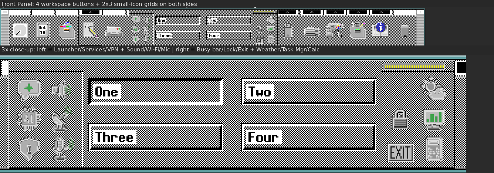
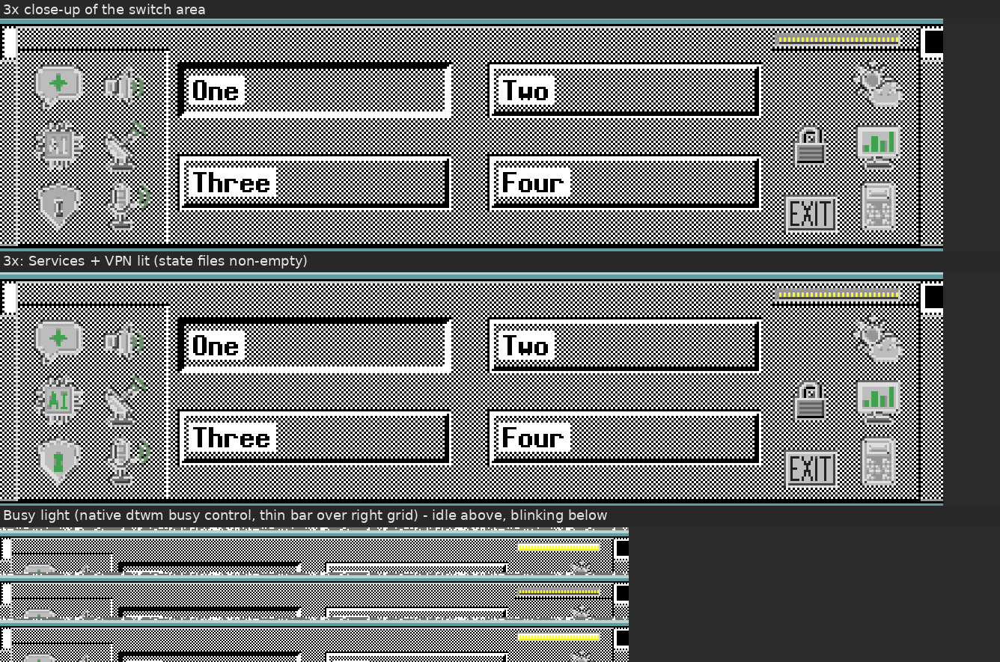
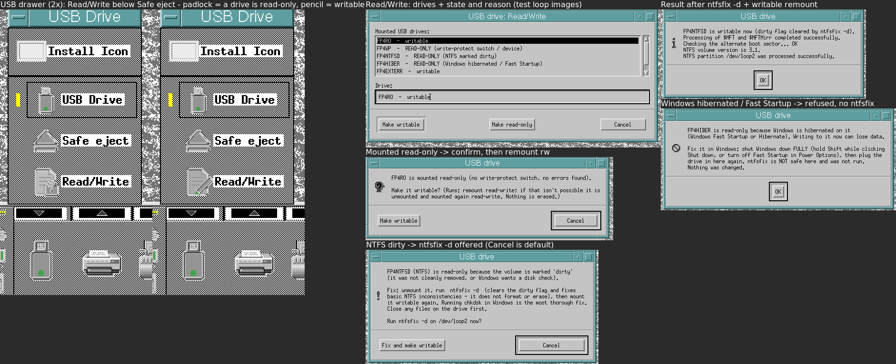
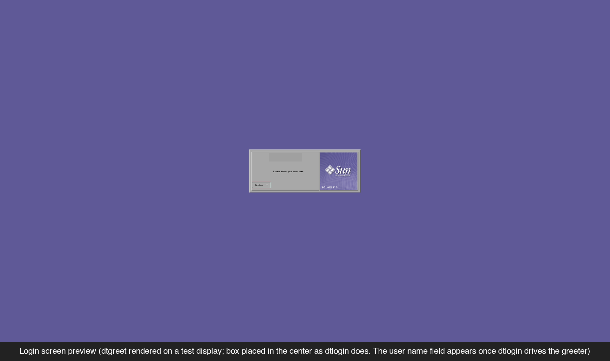
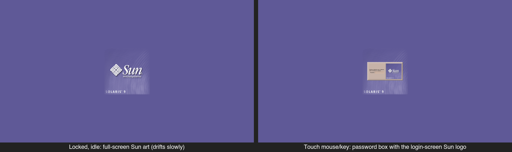

# cde-solaris-panel

A Solaris-flavoured makeover for the **Common Desktop Environment (CDE 2.x)** on Linux:

- **Front Panel grids** – two 2×3 grids of small icons on either side of the four workspace
  buttons, a thin Busy-light bar, and a full-size USB control with a drawer.
- **USB drawer** – *Safe eject* plus a **Read/Write** tool that tells you *why* a drive is
  read-only and fixes it safely.
- **Purple login screen** – Solaris purple (`#5F5997`) around the stock dtlogin box.
- **Purple lock screen** – Solaris purple with a slowly drifting logo (anti burn-in).

All icons in this repo are original artwork drawn in the grey CDE style. No Sun/Solaris logo
files or anything from `/usr/dt` are included – see [Logos and trademarks](#logos-and-trademarks).

## Screenshots

| | |
|---|---|
|  |  |
|  | |
|  |  |

## Layout

```
[ (spacer)        |              | ==== Busy light ==== ]
[ Launcher  Sound |  One    Two  | (spare)   Weather    ]
[ Services  Wi-Fi |              | Lock      Task Mgr   ]
[ VPN       Mic   | Three   Four | Exit      Calculator ]
```

| Cell | What it does |
|---|---|
| Launcher | Runs any command you set (`FP_LAUNCHER_CMD`, default `dtterm`). |
| Services | Starts/stops a group of systemd units and/or Docker containers together (e.g. a local AI stack). Lit while any of them runs. |
| VPN | Optional. Connect/disconnect with your own commands; uses `expressvpnctl` automatically if installed. Never logs server locations. |
| Sound / Mic | Mute toggles for the default PulseAudio/PipeWire sink and source (`pactl`). |
| Wi-Fi | `nmcli radio wifi on/off` only; wired connections untouched. |
| Weather | Current weather + 3-day forecast from [Open-Meteo](https://open-meteo.com) for a location you set. |
| Task Manager | `sdtprocess` if present, else `htop` in `dtterm`, else `xfce4-taskmanager`. |
| Lock / Exit | The normal CDE `LockDisplay` / `ExitSession` actions. |
| USB | Lit while a USB drive is mounted; click to open it. Drawer: **Safe eject**, **Read/Write**. |

### USB Read/Write tool

The drawer icon is a pencil while every mounted USB drive is writable and a padlock when any is
read-only. Clicking it lists the drives with their state and offers **Make writable** /
**Make read-only**. *Make writable* first works out the cause:

- **Write-protect switch / read-only device** – explains it; nothing runs.
- **NTFS hibernated (Windows Fast Startup)** – tells you to shut Windows down fully. `ntfsfix` is *not* offered.
- **NTFS dirty flag** – offers unmount → `ntfsfix -d` → mount writable.
- **ext2/3/4, FAT, exFAT with errors** – runs a *read-only* check first (`-n`); a repair is offered only if that finds problems.
- **Simply mounted read-only** – remounts read-write.

## Requirements

- CDE 2.x (tested on Debian 13), `dtksh`, `dtwm`, `dtsession`
- `sh`, `bash`, `flock`, `lsblk`, `udisksctl`, `python3` (weather), `pactl` (sound/mic), `nmcli` (Wi-Fi)
- To build the grid client: a C compiler, `libx11-dev`, `libxpm-dev`
- To build the lock-screen saver: CDE's headers/libraries (`/usr/dt/include`, `/usr/dt/lib`) and Motif
- Optional: passwordless `sudo -n` for repairs/remounts (otherwise the USB tool falls back to
  `udisksctl` or tells you what is missing), Docker, `expressvpnctl`

## Install

Every installer supports `--dry-run`, backs up what it changes, and never restarts anything.

```sh
git clone https://github.com/user1M-byte/cde-solaris-panel
cd cde-solaris-panel

# 1. Front Panel (writes only ~/.dt, ~/bin, ~/.config)
panel/install.sh --dry-run
panel/install.sh
$EDITOR ~/.config/cde-solaris-panel/panel.conf      # launcher, services, VPN
mkdir -p ~/.config/fp-weather
echo 'Your City, ST|LAT|LON' > ~/.config/fp-weather/location
# log out and back in

# 2. Purple login screen (edits /etc/dt/config/C/Xresources via sudo, with a backup)
login-purple/install.sh

# 3. Purple lock screen (writes ~/bin, ~/.dt, ~/.Xdefaults)
lockscreen-sun/install.sh
```

`panel/install.sh --update` copies newer files over an existing install (backing up first).
If your CDE session directory isn't `~/.dt/<hostname>:0`, set
`FP_SESSIONETC=/path/to/sessionetc` when running install/rollback.

## Undo

```sh
panel/rollback.sh          # stops the grids/watchers, restores replaced files and sessionetc
login-purple/rollback.sh   # restores the backup or removes only the marked block
lockscreen-sun/rollback.sh # removes the marked ~/.Xdefaults block and installed files
```

Each Front Panel install also keeps a full snapshot of `~/.dt` (minus Trash) in
`~/.dt/backup-fpcolumns-v4-<time>/dt.tar.gz`.

## Safety notes

- Nothing here **formats** anything: there is no `mkfs`, `mkntfs`, `wipefs` or `dd` in any script.
- Every USB change asks first in a CDE dialog, with **Cancel** as the default button. A busy
  drive is reported and left alone; if remounting fails after an unmount, the drive is mounted
  read-only again so it isn't left unmounted.
- The panel installer never touches `/usr/dt` and never restarts `dtwm` or logs you out.
- `login-purple` is the only part that writes outside your home directory
  (`/etc/dt/config/C/Xresources`, via `sudo`, backed up first).
- The watchers are read-only pollers (state files under `~/.dt/*-state/`).
- Review the scripts before running them – they're short shell scripts.

## Logos and trademarks

Sun, Sun Microsystems, Solaris and their logos are trademarks of Oracle and/or its affiliates.
This project ships **no** logo artwork. The login screen keeps whatever logo your dtlogin
greeter already shows, and the lock screen uses your system's own
`/etc/dt/appconfig/icons/C/SolarisLogo.pm` (or `/usr/dt/...`, or any XPM you point
`SUNLOCK_LOGO` at) if it exists – otherwise it is plain purple. The screenshots show the
author's own system. This project is not affiliated with or endorsed by Oracle.

## License

MIT – see [LICENSE](LICENSE).
